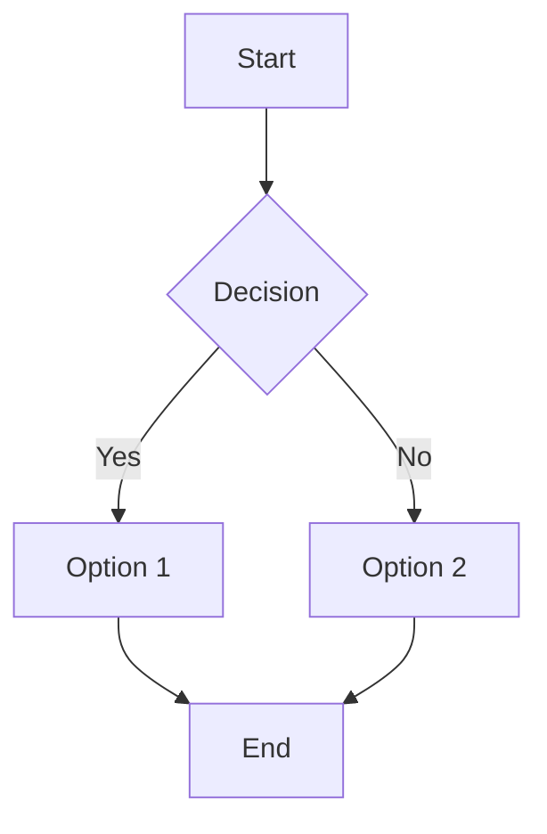
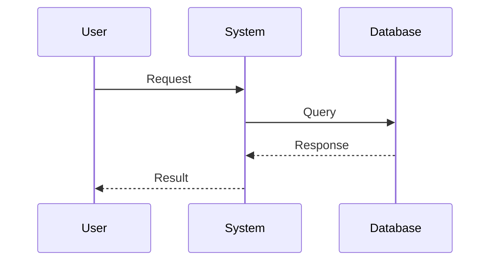

# [Document Title]

**Version**: [Version Number]
**Date**: [YYYY-MM-DD]
**Author**: [Author Name]
**Status**: [Draft | Review | Final]

---

## 📋 Document Information

| Field | Value |
|-------|-------|
| **Document Type** | [Technical Specification | User Guide | API Documentation | etc.] |
| **Target Audience** | [Developers | Users | Administrators | etc.] |
| **Related Documents** | [List related documents] |
| **Last Reviewed** | [YYYY-MM-DD] |
| **Next Review** | [YYYY-MM-DD] |

---

## 📝 Table of Contents

1. [Overview](#overview)
2. [Purpose](#purpose)
3. [Scope](#scope)
4. [Main Content](#main-content)
5. [Examples](#examples)
6. [References](#references)
7. [Appendices](#appendices)

---

## 🎯 Overview

[Provide a brief summary of what this document covers - 2-3 sentences maximum]

### Key Points
- **Point 1**: [Brief description]
- **Point 2**: [Brief description]
- **Point 3**: [Brief description]

---

## 📖 Purpose

[Explain why this document exists and what problem it solves]

### Objectives
1. [Objective 1]
2. [Objective 2]
3. [Objective 3]

---

## 🔍 Scope

### In Scope
- [Item 1]
- [Item 2]
- [Item 3]

### Out of Scope
- [Item 1]
- [Item 2]
- [Item 3]

---

## 📚 Main Content

### Section 1: [Section Title]

[Content for section 1]

#### Subsection 1.1: [Subsection Title]

[Content for subsection 1.1]

**Important Note**: [Highlight important information]

**Best Practices**:
- Practice 1
- Practice 2
- Practice 3

### Section 2: [Section Title]

[Content for section 2]

#### Code Example

```python
# Example code
def example_function():
    """Example function description."""
    return "Hello, World!"
```

#### Configuration Example

```yaml
# Example configuration
setting1: value1
setting2: value2
nested:
  key1: value1
  key2: value2
```

### Section 3: [Section Title]

[Content for section 3]

#### Table Example

| Column 1 | Column 2 | Column 3 |
|----------|----------|----------|
| Value 1  | Value 2  | Value 3  |
| Value 4  | Value 5  | Value 6  |

---

## 💡 Examples

### Example 1: [Example Title]

**Description**: [Brief description of what this example demonstrates]

**Prerequisites**:
- Prerequisite 1
- Prerequisite 2

**Steps**:
1. Step 1 description
   ```bash
   # Command or code
   ```

2. Step 2 description
   ```python
   # Python example
   result = process_data()
   ```

3. Step 3 description

**Expected Output**:
```
Example output here
```

**Troubleshooting**:
- **Issue**: Common problem
  - **Solution**: How to fix it

### Example 2: [Example Title]

[Follow same format as Example 1]

---

## 🔗 References

### Internal References
- [Document Name](link-to-document.md)
- [Another Document](link-to-another-doc.md)

### External References
- [External Resource 1](https://example.com)
- [External Resource 2](https://example.com)

### Related Documentation
- API Documentation: [Link]
- User Guide: [Link]
- Technical Specification: [Link]

---

## 📎 Appendices

### Appendix A: [Appendix Title]

[Appendix content]

### Appendix B: Glossary

| Term | Definition |
|------|------------|
| Term 1 | Definition of term 1 |
| Term 2 | Definition of term 2 |
| Term 3 | Definition of term 3 |

### Appendix C: Frequently Asked Questions (FAQ)

**Q: [Question 1]?**
A: [Answer 1]

**Q: [Question 2]?**
A: [Answer 2]

**Q: [Question 3]?**
A: [Answer 3]

---

## 📊 Change Log

| Version | Date | Author | Description |
|---------|------|--------|-------------|
| 1.0.0 | YYYY-MM-DD | [Name] | Initial version |
| 1.1.0 | YYYY-MM-DD | [Name] | Added section X |
| 1.2.0 | YYYY-MM-DD | [Name] | Updated examples |

---

## ✅ Review and Approval

| Role | Name | Signature | Date |
|------|------|-----------|------|
| Author | [Name] | [Signature] | YYYY-MM-DD |
| Reviewer | [Name] | [Signature] | YYYY-MM-DD |
| Approver | [Name] | [Signature] | YYYY-MM-DD |

---

## 📝 Notes

[Any additional notes, comments, or important information]

### Action Items
- [ ] Action item 1
- [ ] Action item 2
- [ ] Action item 3

### Known Issues
- Issue 1: Description
- Issue 2: Description

---

**Document Status**: [Draft | Under Review | Approved | Archived]
**Last Updated**: [YYYY-MM-DD]
**Next Review Date**: [YYYY-MM-DD]
**Contact**: [email@example.com]

---

## 🎨 Formatting Guide

### Text Formatting
- **Bold text** for emphasis
- *Italic text* for terms
- `Code text` for commands, filenames, variables
- ~~Strikethrough~~ for deprecated items

### Callouts

> **Note**: Important information that users should be aware of.

> **Warning**: Critical information to prevent errors or data loss.

> **Tip**: Helpful suggestions for better results.

> **Important**: Must-read information before proceeding.

### Lists

**Ordered List**:
1. First item
2. Second item
   1. Nested item 1
   2. Nested item 2
3. Third item

**Unordered List**:
- First item
- Second item
  - Nested item
  - Another nested item
- Third item

**Task List**:
- [x] Completed task
- [ ] Pending task
- [ ] Another pending task

### Code Blocks

**Python**:
```python
def example_function(param1, param2):
    """
    Example function with docstring.

    Args:
        param1: First parameter
        param2: Second parameter

    Returns:
        Result value
    """
    return param1 + param2
```

**Bash**:
```bash
#!/bin/bash
# Example bash script

echo "Hello, World!"
```

**JSON**:
```json
{
  "key1": "value1",
  "key2": "value2",
  "nested": {
    "subkey": "subvalue"
  }
}
```

### Diagrams (Mermaid)





### Emojis for Visual Enhancement

- ✅ Success / Completed
- ❌ Error / Failed
- ⚠️ Warning
- 📝 Note / Documentation
- 🔧 Configuration / Settings
- 🚀 Deployment / Launch
- 📊 Analytics / Data
- 🔒 Security
- 💡 Tip / Idea
- 🎯 Goal / Objective
- 📁 File / Folder
- 🌐 Web / Network
- ⏰ Time / Schedule
- 💰 Cost / Pricing
- 🏆 Achievement / Best Practice

---

**Template Version**: 1.0
**Last Updated**: 2025-10-06
**Maintained By**: Development Team
